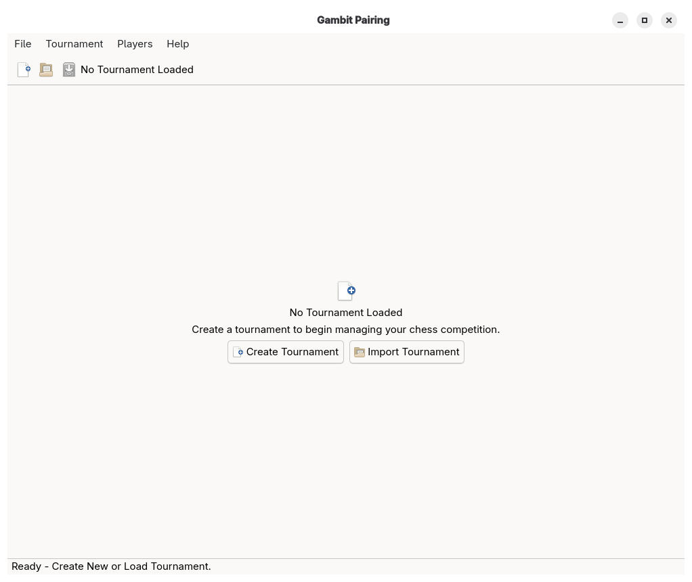
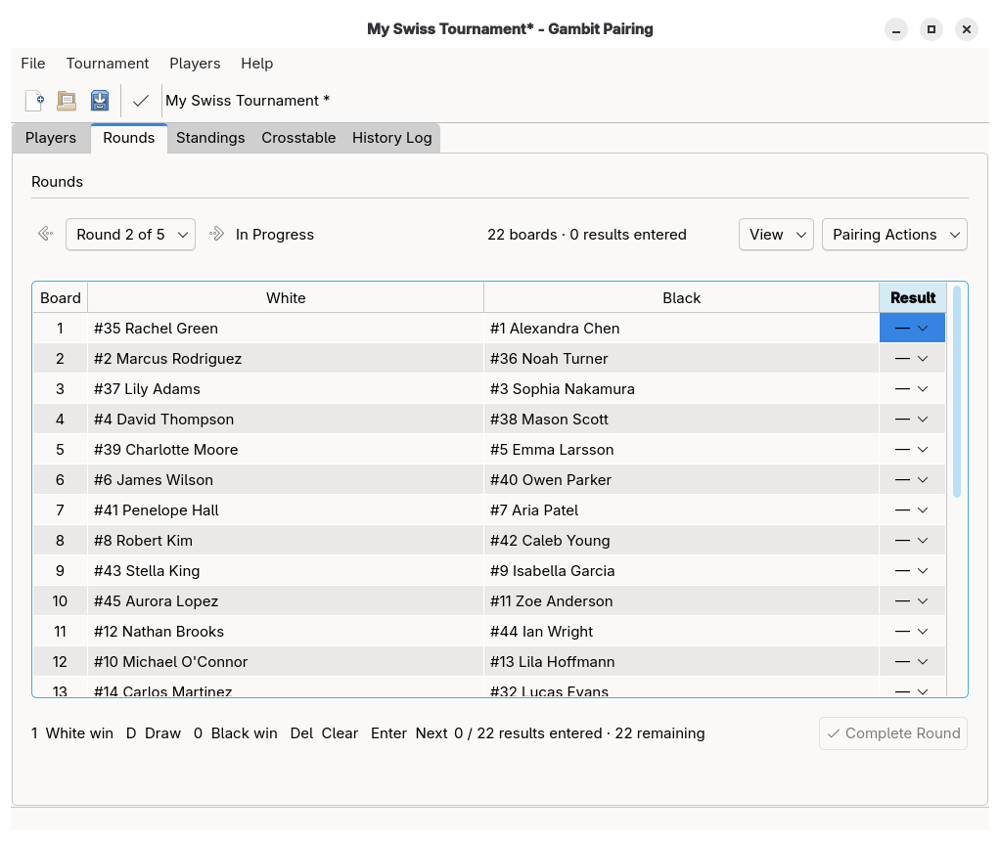
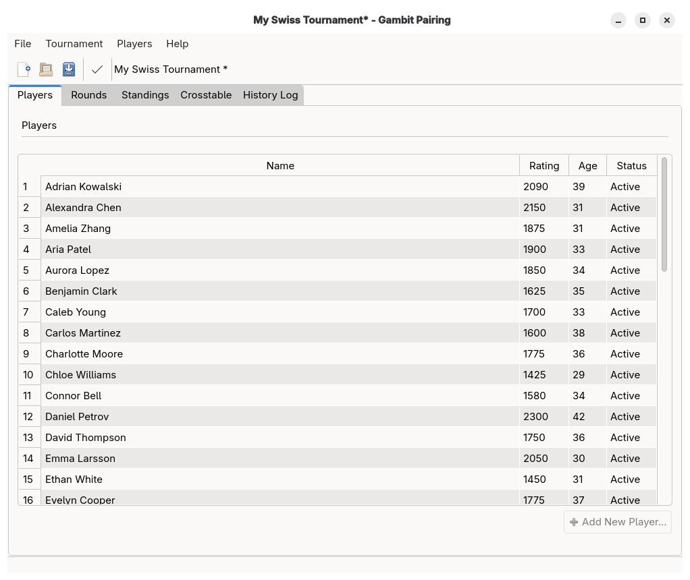
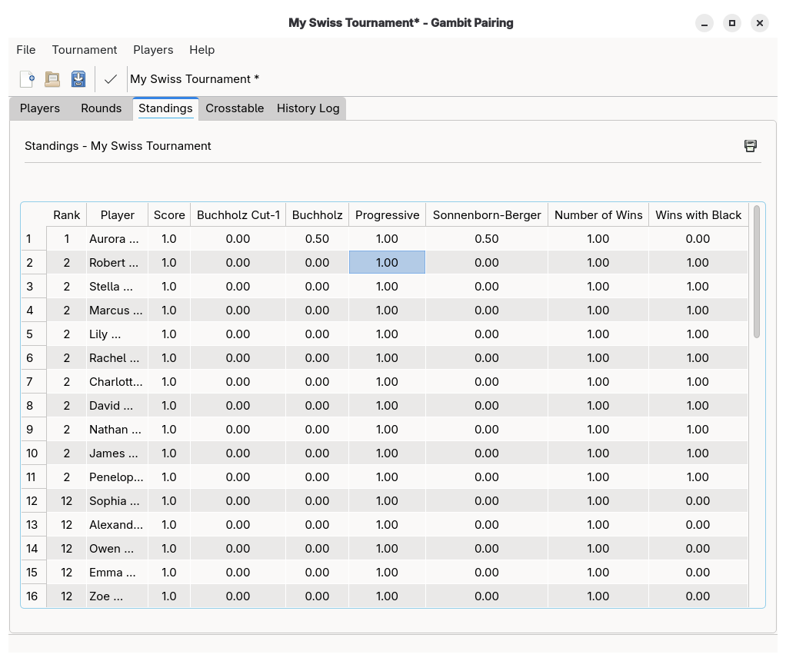
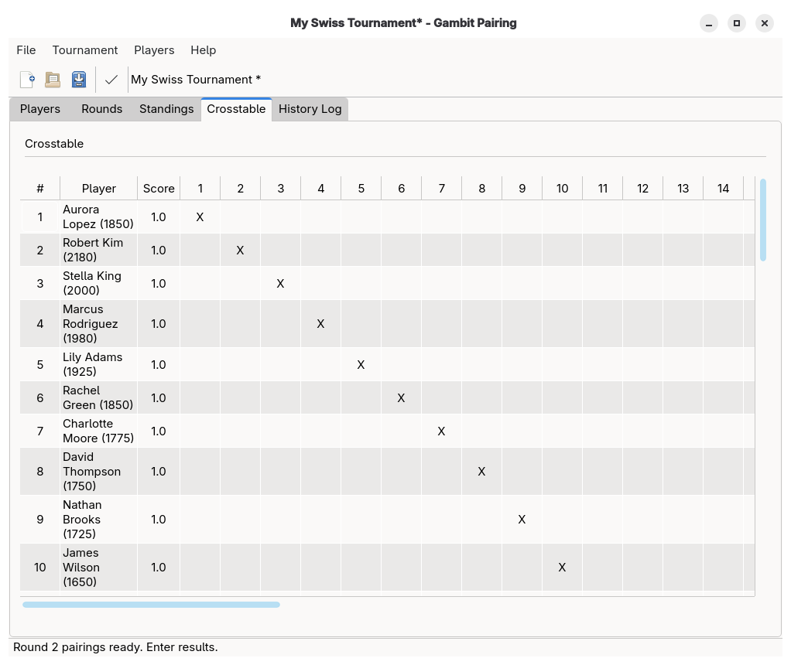
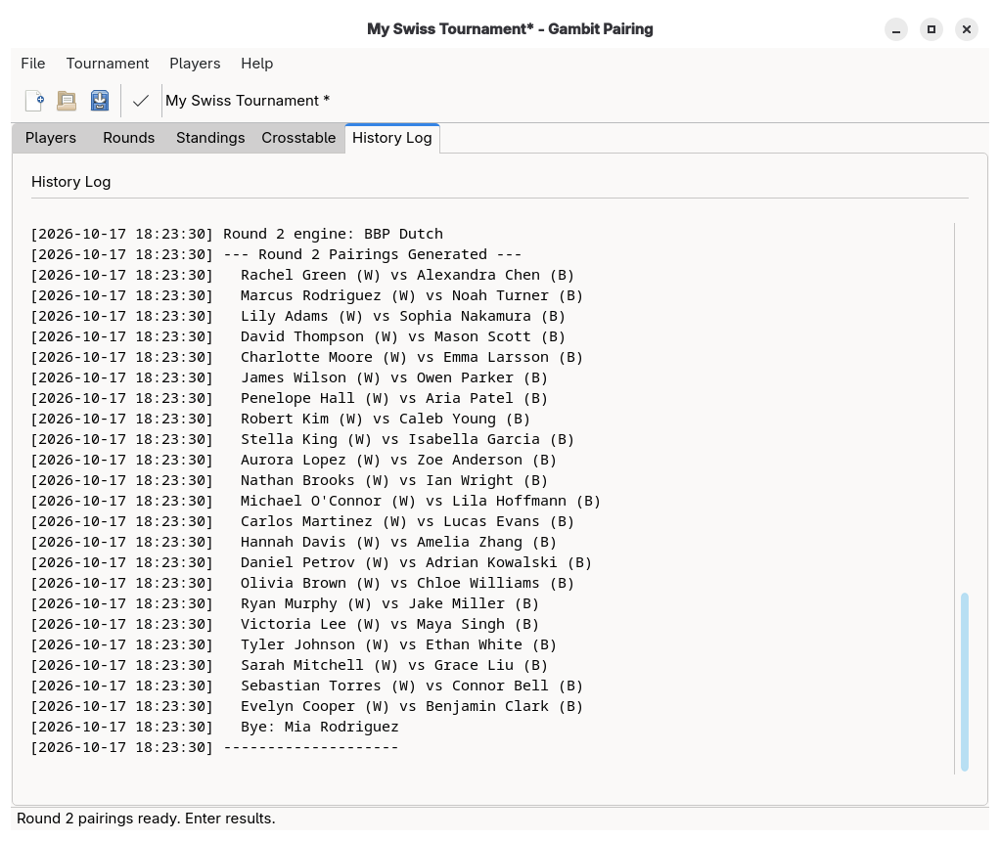
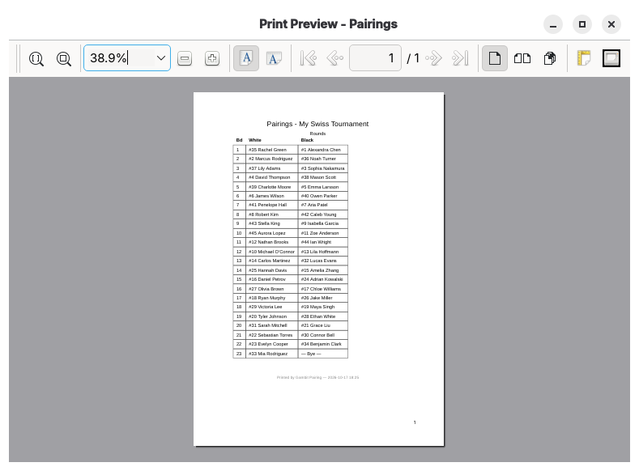
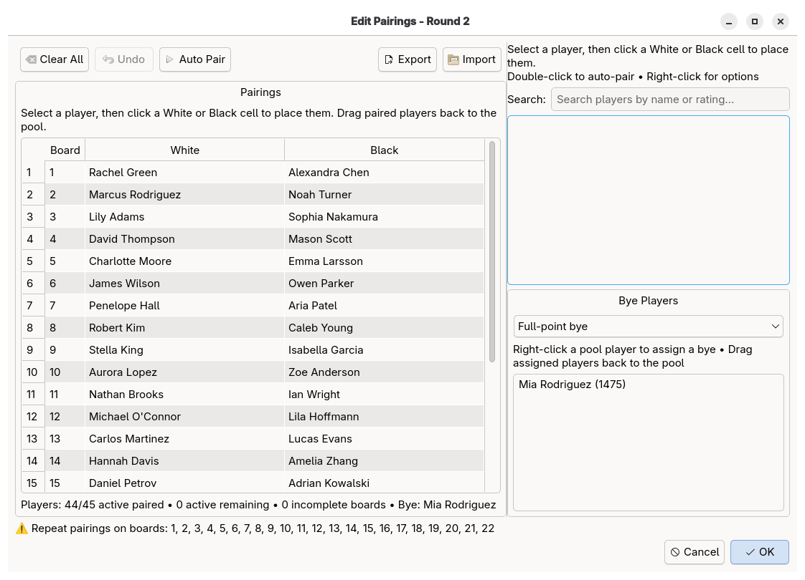
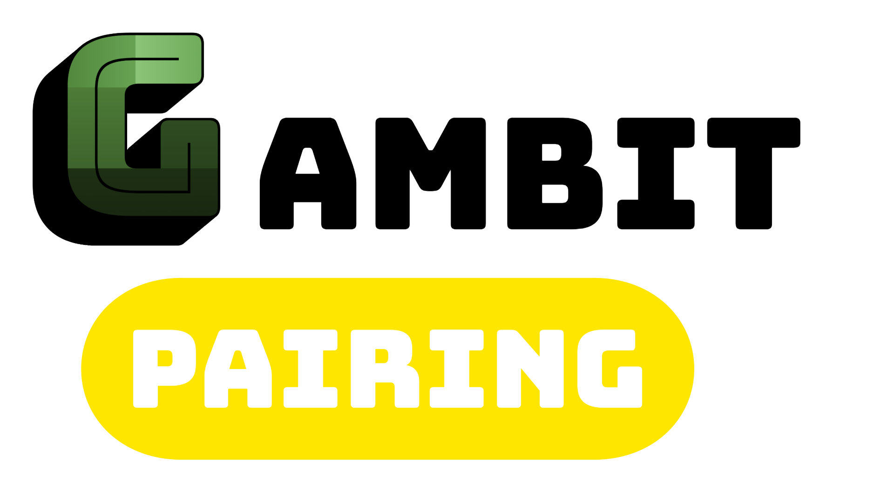

```
                                  $$\       $$\   $$\
                                  $$ |      \__|  $$ |
 $$$$$$\   $$$$$$\  $$$$$$\$$$$\  $$$$$$$\  $$\ $$$$$$\
$$  __$$\  \____$$\ $$  _$$  _$$\ $$  __$$\ $$ |\_$$  _|
$$ /  $$ | $$$$$$$ |$$ / $$ / $$ |$$ |  $$ |$$ |  $$ |
$$ |  $$ |$$  __$$ |$$ | $$ | $$ |$$ |  $$ |$$ |  $$ |$$\
\$$$$$$$ |\$$$$$$$ |$$ | $$ | $$ |$$$$$$$  |$$ |  \$$$$  |
 \____$$ | \_______|\__| \__| \__|\_______/ \__|   \____/
$$\   $$ |
\$$$$$$  |
 \______/
                    $$\           $$\
                    \__|          \__|
 $$$$$$\   $$$$$$\  $$\  $$$$$$\  $$\ $$$$$$$\   $$$$$$\
$$  __$$\  \____$$\ $$ |$$  __$$\ $$ |$$  __$$\ $$  __$$\
$$ /  $$ | $$$$$$$ |$$ |$$ |  \__|$$ |$$ |  $$ |$$ /  $$ |
$$ |  $$ |$$  __$$ |$$ |$$ |      $$ |$$ |  $$ |$$ |  $$ |
$$$$$$$  |\$$$$$$$ |$$ |$$ |      $$ |$$ |  $$ |\$$$$$$$ |
$$  ____/  \_______|\__|\__|      \__|\__|  \__| \____$$ |
$$ |                                            $$\   $$ |
$$ |                                            \$$$$$$  |
\__|                                             \______/
                      ___   ___
                     / _ \ ( _ )
 _____ _____ _____  | | | |/ _ \   _____ _____ _____
|_____|_____|_____| | |_| | (_) | |_____|_____|_____|
                     \___(_)___/
```

[](https://www.gnu.org/licenses/gpl-3.0)
[](https://www.python.org/)
[](https://riverbankcomputing.com/software/pyqt/intro)
[](https://discord.gg/eEnnetMDfr)
[](https://deepwiki.com/Chickaboo/gambit-pairing)

**Important:** Gambit Pairing is in beta development. Features and stability are not guaranteed.

[Join our Discord](https://discord.gg/rNPdxPyMVs)

# About

Gambit Pairing is a free and open-source (FOSS) chess tournament pairing application built for the CFC, FIDE, and USCF. It offers compatible Dutch-Swiss and round-robin system pairings combined with federation tiebreakers and a suite of tournament management features.

## Documentation

- [GAMBIT Test CLI](docs/GAMBIT_TEST_CLI.md)
- [Git Commit Helper](docs/git_commit_helper.md)
- [Developer Hacking Guide](docs/HACKING.md)
- [Installation Guide](docs/installing.md)
- [Manual Pairing Guide](docs/manual-pairing-guide.md)
- [Program Structure](docs/program-structure.md)
- [Project Formatting](docs/project_formatting.md)
- [Virtual Environment Management](docs/virtual_environment_managment.md)
- [Windows Install](docs/windows_install.md)

## Downloads

### Releases

Visit the [Releases page](https://github.com/gambit-devs/gambit-pairing/releases) to download the latest version.

### Python Package

You can also install Gambit Pairing as a Python package using pip:

```bash
pip install gambit-pairing
```

For development or to install from source:

```bash
git clone https://github.com/gambit-devs/gambit-pairing.git
cd gambit-pairing
pip install -e .
```

## Requirements

To install with pip, there is a helper sh script, ensure-all-dependancies.sh

it will parse the pyproject.toml and install all the runtime and development dependancies.

## Usage

1. Install the application:

- see: [installing.md](docs/installing.md)

2. **Create or Load a Tournament:**

   - Use "File > New Tournament..." or "File > Load Tournament..." to start.
   - Configure rounds and tiebreaks in "Settings".

3. **Add Players:**
   - Enter player details (name, rating, gender, etc.) and click "Add New Player...".
   - Import players from CSV via "File > Import Players from CSV...".
   - Edit, withdraw/reactivate, or remove players via right-click context menu.
4. **Start Tournament:**
   - Click "Start Tournament" when ready.
   - No further player additions/removals after starting.
5. **Pairings and Results:**
   - Prepare next round and enter results in the pairings table.
   - Use quick result buttons or select from the dropdown.
   - Manually adjust pairings if needed (right-click pairing row).
   - Undo last round's results if necessary.
6. **Standings & Cross-Table:**
   - View current standings and tiebreaks in the Standings tab.
   - View all results in the Cross-Table tab.
7. **Print:**
   - Print pairings, standings, or player lists via the "File > Print..." menu.
   - Use print preview and select your printer before printing.
8. **Export & Save:**
   - Export standings or player lists via the File menu.
   - Save or load tournaments at any time.
9. **History:**
   - Review all actions and results in the History Log tab.
10. **Check for Updates:**

    - Use "Help > Check for Updates..." to check for new versions (packaged releases only).

## License

This project is open source and available under the GPL-3.0-or-later
[](https://www.gnu.org/licenses/gpl-3.0)

## Screenshots

> _Below are some example screenshots of Gambit Pairing in action._

**About Dialog**



**Tournament Control Tab**



**Player Manager Tab**



**Standings Tab**



**Cross-Table Tab**



**History Log Tab**



**Print Dialog**



**Manual Pairing Dialog**


